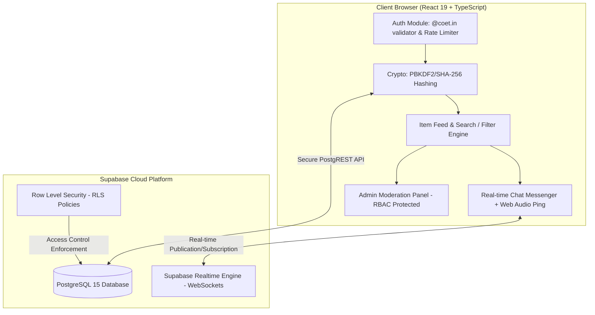

# CampusFinder — College Lost & Found Portal
**Mahatma Gandhi Mission's College of Engineering & Technology, Noida (Sector 62)**

A production-grade, secure web application built with **React 19, TypeScript, Vite, and Supabase (PostgreSQL)** designed specifically for MGM College of Engineering & Technology students and staff to report, track, chat about, and recover lost and found belongings across the campus.

---

## Key Highlights

- **College Domain Restricted Authentication**: Only official `@coet.in` institutional email addresses are permitted to register and access the portal.
- **Strict Input Validation**: University/College Roll Numbers and Mobile Numbers strictly accept **numeric digits only** (no alphabets or special characters allowed, with instant keystroke filtering).
- **Client-Side Cryptographic Security**: Passwords are secure against plaintext exposure using PBKDF2 with SHA-256 (100,000 iterations) and 128-bit unique salt via the native Web Crypto API.
- **Brute-Force Protection**: Client-side rate-limiting enforces a 30-second cooldown after 5 failed login attempts.
- **Real-Time WebSocket Chat**: Peer-to-peer inquiry system with real-time sync across devices and Web Audio notification pings.
- **Item Lifecycle Management**: Items transition smoothly from `lost`/`found` to `claimed` with celebration effects (confetti).
- **Admin Moderation Panel**: Role-based access control (RBAC) allowing college administrators to moderate listings, audit activity, and review claim statuses.
- **OWASP Hardened**: HTTP security headers (CSP, HSTS, X-Frame-Options, Permissions-Policy), file MIME validation, and PostgREST injection sanitization.

---

## Tech Stack

| Layer | Technology |
|---|---|
| **Frontend Framework** | React 19 (Hooks, TypeScript) |
| **Build Tool & Bundler** | Vite 8 + ESNext |
| **Database & Realtime** | Supabase (PostgreSQL 15 + PostgREST + Realtime WebSocket) |
| **Cryptography** | Web Crypto API (`SubtleCrypto` PBKDF2 / SHA-256) |
| **Icons & UI** | Lucide React, Modern CSS (Plus Jakarta Sans, Outfit fonts) |
| **Audio & Effects** | Web Audio API (Synthesized tone generator), Canvas Confetti |
| **Hosting & CI/CD** | GitHub + Netlify (Automated Continuous Deployment) |

---

## System Architecture



---

## Project Structure

```
Campus-Finder/
├── .env.example              # Environment variables template
├── .gitignore                # Production ignore rules (secrets protected)
├── index.html                # Application root with modern typography
├── netlify.toml              # Netlify build config & OWASP security headers
├── package.json              # Project dependencies & scripts
├── supabase-schema.sql       # Complete database schema, RLS policies, & indexes
├── src/
│   ├── main.tsx              # App bootstrap entry point
│   ├── App.tsx               # Primary application state, routing & view orchestrator
│   ├── index.css             # Tailwind/global utility styling
│   ├── App.css               # Application layout styling
│   ├── components/
│   │   ├── AdminPanel.tsx        # Administrator dashboard with moderation tools
│   │   ├── AuthPage.tsx          # Login & registration card with validation & lockout
│   │   ├── ChatMessenger.tsx     # Real-time multi-device conversation drawer
│   │   ├── Footer.tsx            # College portal footer & copyright
│   │   ├── HeroBanner.tsx        # Hero banner with quick stats & call-to-action
│   │   ├── ItemCard.tsx          # Card displaying item details, badges & tags
│   │   ├── ItemDetailModal.tsx   # Detailed item popup with owner contact & chat trigger
│   │   ├── ItemFeed.tsx          # Filterable, searchable grid of campus items
│   │   ├── MyActivity.tsx        # Student personal dashboard (my items & claims)
│   │   ├── Navbar.tsx            # Header with search bar, notifications & user badge
│   │   └── ReportItemModal.tsx   # Modal to report lost/found items with image validation
│   ├── lib/
│   │   ├── crypto.ts         # PBKDF2/SHA-256 password hashing & verification
│   │   ├── sound.ts          # Web Audio synthesized notification chime
│   │   └── supabase.ts       # Supabase client initialization
│   ├── services/
│   │   └── dbService.ts      # Unified database abstraction layer with fallback store
│   └── types/
│       └── index.ts          # TypeScript domain interfaces & types
```

---

## Database Setup (Supabase)

1. Create a free project on [Supabase](https://supabase.com).
2. Open the **SQL Editor** in your Supabase dashboard.
3. Paste and run the entire contents of [`supabase-schema.sql`](./supabase-schema.sql).
   This script automatically:
   - Creates `profiles`, `items`, `messages`, `activity_logs`, and `stats` tables.
   - Enforces PostgreSQL check constraints for categories, statuses, and `@coet.in` domains.
   - Enables Row Level Security (RLS) policies.
   - Configures optimized database indexes for high-speed queries.
   - Enables Supabase Realtime replication on the `messages` table for live chat.

---

## Local Development

### 1. Prerequisites
- Node.js (v18.0.0 or higher recommended)
- npm or pnpm

### 2. Installation
```bash
git clone https://github.com/Navjeet1605-sys/Campus-Finder.git
cd Campus-Finder
npm install
```

### 3. Environment Configuration
Copy the example environment file:
```bash
cp .env.example .env
```
Open `.env` and fill in your Supabase project credentials:
```env
VITE_SUPABASE_URL=https://your-project-id.supabase.co
VITE_SUPABASE_ANON_KEY=your-supabase-anon-key
```

### 4. Run the Dev Server
```bash
npm run dev
```
Open [http://localhost:5173](http://localhost:5173) in your browser.

### 5. Production Build & Linting
```bash
npm run lint    # Runs oxlint static analysis
npm run build   # Typechecks with tsc and bundles with Vite
npm run preview # Preview the production dist bundle locally
```

---

## Deployment (Netlify)

This project includes a production-ready `netlify.toml` file.

1. Push your repository to GitHub.
2. In [Netlify Dashboard](https://app.netlify.com), click **Add new site > Import an existing project**.
3. Select your `Campus-Finder` repository.
4. Netlify will auto-detect the configuration from `netlify.toml`:
   - **Build command**: `npm run build`
   - **Publish directory**: `dist`
5. Go to **Site configuration > Environment variables** and add:
   - `VITE_SUPABASE_URL`
   - `VITE_SUPABASE_ANON_KEY`
6. Click **Deploy Site**. Every push to the `main` branch will automatically build and publish updates.

---

## Security & Compliance Checklist

- [x] **No hardcoded secrets**: All API keys and environment variables are excluded from version control.
- [x] **Cryptographic password storage**: PBKDF2-SHA256 with 100,000 rounds and random salt.
- [x] **Brute-force mitigation**: 5-attempt threshold with automatic cooldown timer.
- [x] **PostgREST filter injection protection**: Sanitized query inputs preventing syntax escapes.
- [x] **File upload safety**: MIME-type validation (`image/jpeg`, `image/png`, `image/webp`) and 5MB size limit.
- [x] **HTTP response headers**: Enforced CSP, HSTS, `X-Frame-Options: DENY`, `X-Content-Type-Options: nosniff`.
- [x] **Role-Based Access Control**: Strict client and database RLS checks for administrative actions.

---

## License & Attribution

Designed and developed for **Mahatma Gandhi Mission's College of Engineering and Technology, Noida (Sector 62)**.
Created for student campus utility and asset recovery.
